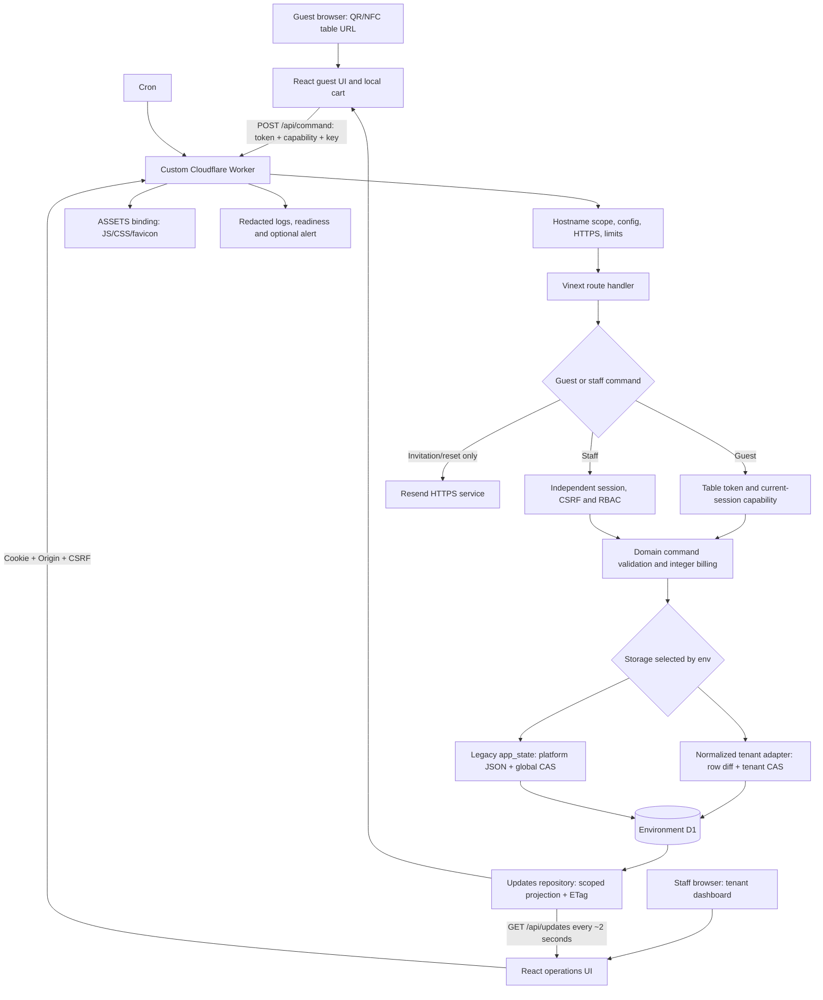

# System architecture

## Implemented components

| Component | Actual implementation / responsibility |
| --- | --- |
| Frontend | React 19.2.6 App Router files, client hooks/state and components; primary UI app/tab2serve.tsx, app/split-bill.tsx, app/i18n.tsx and restaurant-designs. Tailwind 4 plus authored CSS; mostly monolithic dashboard/guest modules, no Redux/global external store. |
| Framework/build | Vinext 1.0.0-beta.5 reimplements the used Next APIs on Vite 8.0.13; @vitejs/plugin-rsc 0.5.26, @cloudflare/vite-plugin 1.37.1. next 16.3.4 is installed but this is not a conventional Next Node deployment. |
| Worker | worker/index.ts wraps Vinext fetch-handler with hostname classification, readiness/config guards, HTTPS/maintenance, native limiters, request scope, asset dispatch, safe response headers and structured logs. scheduled() runs monitoring/auth cleanup. |
| Domain | lib/domain.mjs: permission checks, lifecycle, integer prices, order snapshots, idempotency and command dispatch. lib/share-calculator.mjs: pure local allocation math. |
| Persistence | lib/store.ts chooses legacy or normalized mode through env.DB. lib/normalized-store.mjs maps one tenant into domain state and diffs it into SQL. db/index.ts exposes optional Drizzle D1 helper; core commands use prepared D1 SQL directly. |
| Request scope | lib/tenant-routing.mjs resolves registered root/slug; lib/tenant-context.ts uses AsyncLocalStorage, validated per actual request origin. Client restaurant IDs cannot override tenant hostname. |
| Authentication | app/auth.ts chooses independent auth or compatibility identity. Independent service is lib/auth-service.mjs + crypto, server, background and maintenance modules; Sites headers/mock cookie and verified Access JWT support exist in separate paths. |
| Updates | app/api/updates/route.ts + lib/updates-repository.mjs: permission-scoped snapshots, ETag/304 and paginated histories. lib/polling.mjs schedules one poll at a time, default 2 seconds after completion, pauses hidden/offline work, discards stale responses and backs off failures. |
| External services | Resend HTTPS API for staff activation/reset; optional approved health webhook; external HTTPS menu/design images (browser-fetched). Connector capability scaffolding is retained but no implemented restaurant POS integration depends on it. |
| Operations | Wrangler examples, staged SQL, offline normalized/auth provisioning and encrypted SQL recovery tools. No CI workflow or automated remote migration/backup pipeline was found in authored repository files. |

## Architecture diagram

Independent auth is required by strict standalone production config. Legacy/Sites
paths in the diagram are compatibility implementations, not claims about the
current hosted provider. All environments use one DB binding named DB; actual
staging and production database IDs must differ.

## API inventory

| Route/method | Responsibility and gate |
| --- | --- |
| GET /api/state | Initial public guest table view when table token supplied, otherwise authenticated permission-filtered staff/platform state. |
| GET /api/updates | Guest/current-session or authenticated staff conditional snapshot; validates view/cursor, excludes private projections; emits diagnostic snapshot-query headers. |
| POST /api/command | Bounded JSON, action validation, guest limiter or staff auth/CSRF/recent-login, then authoritative domain transaction. |
| GET /api/design | Super Admin design draft/management state, on admin/local origin only. Mutations go through platform.design.* commands. |
| GET /api/auth/session | Independent session/CSRF projection; anonymous 401 in independent mode. Compatibility mode reports independent:false. |
| POST /api/auth/login,logout | Password/TOTP login with rate counters; logout requires session+CSRF. |
| POST /api/auth/recovery,activation-info,activate | Generic recovery, origin-bound one-hour single-use activation/reset and MFA enrollment. |
| POST /api/auth/invitations,password,disable | Recent authenticated invitation authority; current-password change; Super Admin account disable on admin origin. |
| GET/HEAD /healthz,/readyz | Generic liveness and configuration/D1 readiness; only platform/admin/local hosts. Readiness is narrower than full business acceptance. |

`examples/d1/app/api/notes/route.ts` is documentation/sample source outside the
root app route tree, not an implemented production notes API. Connector preview
services are development scaffolding, not public app endpoints. Browser routes
include /, /dashboard, /login, /logout, /activate, /account and private /design-preview.

## Guest action, end to end

1. A stand carries `https://<slug>.tap2serve.com/?table=<opaque-token>`. The
   browser loads the tenant menu and current table session projection.
2. Cart quantities/modifiers/notes remain client state until submission. A
   current-session capability is read into memory; a fresh idempotency key is sent
   with the guest.order command. Table URL access is bearer access, not physical
   presence or an individual diner account.
3. Worker derives tenant from the real URL, applies configuration and abuse gates;
   the API bounds JSON and validates token/action/quantity syntax. The domain
   reloads current menu/session/prices and permissions; client prices are ignored.
4. Normalized storage reads only that restaurant, computes changed rows and uses
   a guarded atomic batch. A revision conflict reloads/revalidates, at most eight
   attempts. Legacy mode instead retries the one global JSON revision CAS.
5. The dashboard's next poll sees a new tenant revision and returns a fresh
   authorized snapshot. New order IDs trigger an in-app notification. A repeated
   identical order key returns the original order; divergent payload reuse fails.
6. Bill request pauses ordering, explicit reopening resumes it, and finalization
   freezes money snapshots. Cash/card recording settles the full due amount;
   closing releases the table/capability without deleting history.

## Configuration and version evidence

Inventory: package.json/package-lock.json, vite.config.ts, worker/index.ts,
cloudflare-env.d.ts and config/wrangler.*.example.jsonc. Server variables cover
production/storage/auth selection, roots/legacy bridge/maintenance and local-only
flags. Secrets cover rate-key HMAC, MFA encryption, Resend and optional alerts.
Offline backup key and Cloudflare deployment token are operator-only. Do not
expose any through VITE_* or NEXT_PUBLIC_*.

Compatibility is nodejs_compat at 2026-05-15. Builds emit dist/server/index.js plus
67 additional modules and dist/client assets; operator configs upload these
without rebundling. The generated Sites placeholder config is not a standalone
production identity. The dependency appendix in evidence/dependencies.json records
every direct declared and lock-resolved version. Current advisories make those
versions unacceptable for a new public release without remediation.
