# Database audit

## Actual technology and activation state

Cloudflare D1 (SQLite) is accessed through env.DB using prepared statements and
D1 batch. Drizzle exports schema/helper definitions, but domain persistence is
custom SQL. Offline migration/backup tests use Node SQLite; Miniflare tests run
D1-compatible batches in workerd. No production database was connected/read.

There are **two implemented storage paths**, not an assumed completed cutover:

| Mode | Actual behavior |
| --- | --- |
| Legacy (unset or legacy) | app_state/main contains platformOwner, every restaurant and all histories in one JSON payload. readState loads all; transaction applies domain logic and CAS-updates revision, retrying eight times. Payload limited to 1.8 million characters. |
| Normalized | lib/normalized-store.mjs uses tenant entities, prepared SQL, per-restaurant revisions and one atomic guarded batch. Requires exactly one verified migration_runs entry at model version 3. It never bootstraps sample data or falls back to stale JSON. |
| Strict hosted guard | lib/operations.mjs requires normalized + independent auth, secrets and native limiters. Local compatibility is explicit and must never be enabled on hosted public environments. |

The combined implemented DDL, instantiated only in a new in-memory database for
this audit, contains **32 tables, 267 columns, 39 explicitly authored indexes**
(additional SQLite autoindexes enforce PK/UNIQUE). This union includes the legacy
table; it is not a dump or assertion of any live database's tables.

## Relationships and isolation

Core groups: restaurants; memberships/permissions/users; menus/categories/items/
modifiers; dining_tables/sessions; orders/items/modifier snapshots; bills/payments;
service_requests/feedback; subscriptions/setup; tenant/platform audit; platform
configuration/migration/commit guards. Auth adds accounts, sessions, action tokens,
rate buckets, readiness, guards and security events.

Tenant entities use composite restaurant_id/id keys and parent references where
applicable. Unique table tokens, restaurant slugs, table labels, idempotency keys
and partial unique occupied-session constraints enforce boundaries. Session/order
states, integer money/quantity/version/booleans and JSON envelopes have CHECKs.
Foreign keys restrict deletion. Historical sold menu IDs and actor display values
are snapshots, intentionally not all live-definition foreign keys. The generated
ER below shows only actual declared foreign keys; snapshot semantics must not be
mistaken for enforced relationships. Its many-side notation describes the FK
direction conservatively; unique constraints in the dictionary further restrict
one-to-one cases (e.g. bills/subscriptions).

`position` preserves order; present_json distinguishes missing vs null; extra_json
preserves retired/unknown data; restaurant design/translation metadata remains
bounded JSON. This is a relational operational model with compatibility fields,
not a per-tenant opaque state blob. No database-level row-level-security policy is
present; application authorization and tenant FKs remain essential.

## Transactions, validation and concurrency

Normalized mutate loads a restaurant snapshot, reruns domain authorization, diffs
rows, asserts its revision through a CHECK-protected transient guard, writes
changes/audit, increments revision and removes guard in DB.batch. Constraint or
CAS failure rolls the whole batch back. Only recognized CAS conflicts retry.
The application caps a command at 800 statements and individual SQL uses bound
parameters. Financial changes are not split across independent commits.

Tests exercise competing opens, same/different tenant updates, duplicate
orders/payments, stale order versions, bill/order races, FK constraints and failed
batch rollback. Actual distributed regional latency and busiest-venue contention
are not measured. Tenant CAS serializes each restaurant's writes; independent
restaurants avoid one shared application revision but still share D1 capacity.

## Performance and retention findings

Updates have indexed tenant metadata/ETag checks and page size 50 for history,
feedback and service (activity 150), retaining live/unpaid/pending work. A 304
still performs routing/auth/metadata queries. Initial state, publicRestaurant and
mutations still reconstruct the whole tenant, including its retained history.
This grows CPU/memory/reads even though changed-row writes are narrow.

The isolated normalized polling fixture reported 744 snapshot rows read for a
fresh response versus 9 for unchanged metadata, excluding strict auth/hostname
overhead. Full-platform JSON traversal remains in the legacy path. Security audit
events and financial/business history have no implemented retention/archive job;
auth cleanup only expires session/action/rate material. No capacity or financial
retention policy can be inferred from SQL constraints.

## Migrations and recovery

Legacy drizzle/0000 creates app_state. Normalized/auth/poll-index SQL lives in
db/staged/0001,0002,0003; operator configs explicitly point migrations_dir there.
The staged migrations are outside the legacy Drizzle journal. CREATE IF NOT
EXISTS does not upgrade earlier normalized column definitions. db:generate can
mutate migration files and was not run during this audit. Generated-schema parity
tests passed; the exact SQL was instantiated and introspected without real data.

Offline prepare/verify/verify-export retains the exact JSON source, revision,
source hash, row counts/values, reconstructed canonical state and FK/integrity
checks. Activation markers are manual. Identity migration must separately retain
users/auth rows and MFA encryption keys; business JSON cannot reconstruct them.

Encrypted backups authenticate SQL/source/schema/data hashes with AES-GCM.
rehearse restores isolated state; prepare-recovery revokes restored auth/reset
tokens and rotates active guest capabilities while preserving permanent stand
tokens and financial history. The helper caps SQL at 128 MiB and uses memory;
NTFS ACLs/key escrow and larger restores need separate operations. Tests passed,
including an isolated real local D1 restore. No hosted backup schedule, offsite
backup, measured RPO/RTO or live restore drill was verified.

Before new writes a compatible prior binding/code can be restored under a freeze.
After new normalized writes, switching to a stale legacy DB loses orders/payments;
repair forward or reconcile a new recovery copy. Reverse migration/down scripts
are not implemented. Whole-DB Time Travel overwrites later writes and can revive
old credentials. Never restore over production just to test a backup.

## Multi-restaurant verdict

**Implemented and locally tested for isolation and consistency, conditionally
suitable for a limited staged pilot after security remediation.** Not yet proven
safe for sustained live multi-venue operation because migration, browser/device,
retention, recovery and load gates remain open. Legacy storage is unsuitable for
unbounded multi-restaurant growth; normalized storage is not unlimited scale.

## Implemented ER diagram

The following diagram and complete column/index/constraint dictionary are
generated by tests/project-audit-schema.mjs from the authored SQL, not an ideal
future schema. All data used for inspection was empty/in-memory.

```mermaid
erDiagram
    app_state {
        TEXT id PK
    }
    audit_events {
        TEXT restaurant_id PK
        TEXT id PK
    }
    auth_accounts {
        TEXT user_id PK
    }
    auth_action_tokens {
        TEXT token_hash PK
        TEXT user_id FK
    }
    auth_config {
        TEXT id PK
    }
    auth_events {
        TEXT id PK
    }
    auth_guards {
        TEXT id PK
    }
    auth_rate_buckets {
        TEXT bucket_key PK
    }
    auth_sessions {
        TEXT token_hash PK
        TEXT user_id FK
    }
    bills {
        TEXT restaurant_id PK
        TEXT id PK
        TEXT session_id FK
    }
    commit_guards {
        TEXT id PK
    }
    dining_tables {
        TEXT restaurant_id PK
        TEXT id PK
    }
    feedback {
        TEXT restaurant_id PK
        TEXT id PK
        TEXT session_id FK
        TEXT table_id FK
    }
    membership_permissions {
        TEXT restaurant_id PK
        TEXT membership_id PK
        INTEGER position PK
    }
    memberships {
        TEXT restaurant_id PK
        TEXT id PK
        TEXT user_id FK
    }
    menu_categories {
        TEXT restaurant_id PK
        TEXT id PK
        TEXT menu_id FK
    }
    menu_items {
        TEXT restaurant_id PK
        TEXT id PK
        TEXT menu_id FK
    }
    menu_modifiers {
        TEXT restaurant_id PK
        TEXT id PK
        TEXT item_id FK
    }
    menus {
        TEXT restaurant_id PK
        TEXT id PK
    }
    migration_runs {
        TEXT id PK
    }
    order_item_modifiers {
        TEXT restaurant_id PK
        TEXT id PK
        TEXT order_item_id FK
    }
    order_items {
        TEXT restaurant_id PK
        TEXT id PK
        TEXT order_id FK
    }
    orders {
        TEXT restaurant_id PK
        TEXT id PK
        TEXT session_id FK
    }
    payments {
        TEXT restaurant_id PK
        TEXT id PK
        TEXT session_id FK
    }
    platform_audit {
        TEXT id PK
        TEXT restaurant_id FK
    }
    platform_config {
        TEXT id PK
        TEXT owner_id FK
    }
    restaurant_setup {
        TEXT restaurant_id PK
        TEXT id PK
    }
    restaurants {
        TEXT restaurant_id PK
        TEXT id PK
    }
    service_requests {
        TEXT restaurant_id PK
        TEXT id PK
        TEXT session_id FK
        TEXT table_id FK
    }
    sessions {
        TEXT restaurant_id PK
        TEXT id PK
        TEXT table_id FK
    }
    subscriptions {
        TEXT restaurant_id PK
        TEXT id PK
    }
    users {
        TEXT id PK
    }
    restaurants ||--o{ audit_events : "restaurant_id"
    users ||--o{ auth_accounts : "user_id"
    auth_accounts ||--o{ auth_action_tokens : "user_id"
    auth_accounts ||--o{ auth_sessions : "user_id"
    sessions ||--o{ bills : "restaurant_id+session_id"
    restaurants ||--o{ bills : "restaurant_id"
    restaurants ||--o{ dining_tables : "restaurant_id"
    dining_tables ||--o{ feedback : "restaurant_id+table_id"
    sessions ||--o{ feedback : "restaurant_id+session_id"
    restaurants ||--o{ feedback : "restaurant_id"
    memberships ||--o{ membership_permissions : "restaurant_id+membership_id"
    users ||--o{ memberships : "user_id"
    restaurants ||--o{ memberships : "restaurant_id"
    menus ||--o{ menu_categories : "restaurant_id+menu_id"
    restaurants ||--o{ menu_categories : "restaurant_id"
    menus ||--o{ menu_items : "restaurant_id+menu_id"
    restaurants ||--o{ menu_items : "restaurant_id"
    menu_items ||--o{ menu_modifiers : "restaurant_id+item_id"
    restaurants ||--o{ menu_modifiers : "restaurant_id"
    restaurants ||--o{ menus : "restaurant_id"
    order_items ||--o{ order_item_modifiers : "restaurant_id+order_item_id"
    restaurants ||--o{ order_item_modifiers : "restaurant_id"
    orders ||--o{ order_items : "restaurant_id+order_id"
    restaurants ||--o{ order_items : "restaurant_id"
    sessions ||--o{ orders : "restaurant_id+session_id"
    restaurants ||--o{ orders : "restaurant_id"
    sessions ||--o{ payments : "restaurant_id+session_id"
    restaurants ||--o{ payments : "restaurant_id"
    restaurants ||--o{ platform_audit : "restaurant_id"
    users ||--o{ platform_config : "owner_id"
    restaurants ||--o{ restaurant_setup : "restaurant_id"
    dining_tables ||--o{ service_requests : "restaurant_id+table_id"
    sessions ||--o{ service_requests : "restaurant_id+session_id"
    restaurants ||--o{ service_requests : "restaurant_id"
    dining_tables ||--o{ sessions : "restaurant_id+table_id"
    restaurants ||--o{ sessions : "restaurant_id"
    restaurants ||--o{ subscriptions : "restaurant_id"
```



## Complete implemented column/index/constraint dictionary

### app_state

| Column | SQLite type | Required | PK position | Default |
| --- | --- | --- | --- | --- |
| id | TEXT | Yes | 1 |  |
| revision | INTEGER | Yes |  | 0 |
| payload | TEXT | Yes |  |  |

Foreign keys: none.

Indexes: sqlite_autoindex_app_state_1 (id) UNIQUE.

<details><summary>Exact implemented DDL and explicit indexes</summary>

```sql
CREATE TABLE `app_state` (
	`id` text PRIMARY KEY NOT NULL,
	`revision` integer DEFAULT 0 NOT NULL,
	`payload` text NOT NULL
);

```

</details>

### audit_events

| Column | SQLite type | Required | PK position | Default |
| --- | --- | --- | --- | --- |
| restaurant_id | TEXT | Yes | 1 |  |
| id | TEXT | Yes | 2 |  |
| position | INTEGER | Yes |  | 0 |
| extra_json | TEXT | Yes |  | '{}' |
| present_json | TEXT | Yes |  | '[]' |
| occurred_at | TEXT | No (or enforced by PK/schema) |  |  |
| actor | TEXT | No (or enforced by PK/schema) |  |  |
| action | TEXT | No (or enforced by PK/schema) |  |  |
| detail | TEXT | No (or enforced by PK/schema) |  |  |

Foreign keys: restaurant_id → restaurants.id (group 0, NO ACTION).

Indexes: audit_events_recent (restaurant_id, actor, occurred_at); audit_events_history_position (restaurant_id, position); sqlite_autoindex_audit_events_1 (restaurant_id, id) UNIQUE.

<details><summary>Exact implemented DDL and explicit indexes</summary>

```sql
CREATE TABLE audit_events (
  restaurant_id TEXT NOT NULL,
  id TEXT NOT NULL,
  position INTEGER NOT NULL DEFAULT 0,
  extra_json TEXT NOT NULL DEFAULT '{}',
  present_json TEXT NOT NULL DEFAULT '[]',
  occurred_at TEXT,
  actor TEXT,
  action TEXT,
  detail TEXT,
  PRIMARY KEY(restaurant_id,id),
  CONSTRAINT audit_events_extra_json CHECK(json_valid(extra_json)),
  CONSTRAINT audit_events_present_json CHECK(json_valid(present_json)),
  FOREIGN KEY(restaurant_id) REFERENCES restaurants(id)
);
CREATE INDEX audit_events_recent ON audit_events (restaurant_id,actor,occurred_at);
CREATE INDEX audit_events_history_position ON audit_events (restaurant_id,position);
```

</details>

### auth_accounts

| Column | SQLite type | Required | PK position | Default |
| --- | --- | --- | --- | --- |
| user_id | TEXT | No (or enforced by PK/schema) | 1 |  |
| email | TEXT | Yes |  |  |
| display_name | TEXT | Yes |  |  |
| password_hash | TEXT | No (or enforced by PK/schema) |  |  |
| active | INTEGER | Yes |  | 1 |
| is_super_admin | INTEGER | Yes |  | 0 |
| version | INTEGER | Yes |  | 1 |
| email_verified_at | INTEGER | No (or enforced by PK/schema) |  |  |
| mfa_secret_enc | TEXT | No (or enforced by PK/schema) |  |  |
| mfa_last_step | INTEGER | Yes |  | -1 |
| created_at | INTEGER | Yes |  |  |

Foreign keys: user_id → users.id (group 0, NO ACTION).

Indexes: sqlite_autoindex_auth_accounts_2 (email) UNIQUE; sqlite_autoindex_auth_accounts_1 (user_id) UNIQUE.

<details><summary>Exact implemented DDL and explicit indexes</summary>

```sql
CREATE TABLE auth_accounts(
 user_id TEXT PRIMARY KEY REFERENCES users(id),
 email TEXT NOT NULL UNIQUE CHECK(email=lower(email)),
 display_name TEXT NOT NULL,
 password_hash TEXT,
 active INTEGER NOT NULL DEFAULT 1 CHECK(active IN(0,1)),
 is_super_admin INTEGER NOT NULL DEFAULT 0 CHECK(is_super_admin IN(0,1)),
 version INTEGER NOT NULL DEFAULT 1 CHECK(version>=1),
 email_verified_at INTEGER,
 mfa_secret_enc TEXT,
 mfa_last_step INTEGER NOT NULL DEFAULT -1,
 created_at INTEGER NOT NULL
);

```

</details>

### auth_action_tokens

| Column | SQLite type | Required | PK position | Default |
| --- | --- | --- | --- | --- |
| token_hash | TEXT | No (or enforced by PK/schema) | 1 |  |
| user_id | TEXT | Yes |  |  |
| kind | TEXT | Yes |  |  |
| account_version | INTEGER | Yes |  |  |
| origin | TEXT | Yes |  |  |
| expires_at | INTEGER | Yes |  |  |
| used_at | INTEGER | No (or enforced by PK/schema) |  |  |
| mfa_enrollment_enc | TEXT | No (or enforced by PK/schema) |  |  |
| created_by | TEXT | No (or enforced by PK/schema) |  |  |
| created_at | INTEGER | Yes |  |  |

Foreign keys: user_id → auth_accounts.user_id (group 0, NO ACTION).

Indexes: auth_action_tokens_user (user_id, expires_at); sqlite_autoindex_auth_action_tokens_1 (token_hash) UNIQUE.

<details><summary>Exact implemented DDL and explicit indexes</summary>

```sql
CREATE TABLE auth_action_tokens(
 token_hash TEXT PRIMARY KEY,
 user_id TEXT NOT NULL REFERENCES auth_accounts(user_id),
 kind TEXT NOT NULL CHECK(kind IN('activate','reset')),
 account_version INTEGER NOT NULL,
 origin TEXT NOT NULL,
 expires_at INTEGER NOT NULL,
 used_at INTEGER,
 mfa_enrollment_enc TEXT,
 created_by TEXT,
 created_at INTEGER NOT NULL
);
CREATE INDEX auth_action_tokens_user ON auth_action_tokens(user_id,expires_at);
```

</details>

### auth_config

| Column | SQLite type | Required | PK position | Default |
| --- | --- | --- | --- | --- |
| id | TEXT | No (or enforced by PK/schema) | 1 |  |
| ready | INTEGER | Yes |  | 0 |
| schema_version | INTEGER | Yes |  | 1 |

Foreign keys: none.

Indexes: sqlite_autoindex_auth_config_1 (id) UNIQUE.

<details><summary>Exact implemented DDL and explicit indexes</summary>

```sql
CREATE TABLE auth_config(id TEXT PRIMARY KEY CHECK(id='main'), ready INTEGER NOT NULL DEFAULT 0 CHECK(ready IN(0,1)), schema_version INTEGER NOT NULL DEFAULT 1);

```

</details>

### auth_events

| Column | SQLite type | Required | PK position | Default |
| --- | --- | --- | --- | --- |
| id | TEXT | No (or enforced by PK/schema) | 1 |  |
| user_id | TEXT | No (or enforced by PK/schema) |  |  |
| actor_id | TEXT | No (or enforced by PK/schema) |  |  |
| event | TEXT | Yes |  |  |
| at | INTEGER | Yes |  |  |

Foreign keys: none.

Indexes: auth_events_recent (at, user_id); sqlite_autoindex_auth_events_1 (id) UNIQUE.

<details><summary>Exact implemented DDL and explicit indexes</summary>

```sql
CREATE TABLE auth_events(id TEXT PRIMARY KEY,user_id TEXT,actor_id TEXT,event TEXT NOT NULL,at INTEGER NOT NULL);
CREATE INDEX auth_events_recent ON auth_events(at,user_id);
```

</details>

### auth_guards

| Column | SQLite type | Required | PK position | Default |
| --- | --- | --- | --- | --- |
| id | TEXT | No (or enforced by PK/schema) | 1 |  |
| valid | INTEGER | Yes |  |  |

Foreign keys: none.

Indexes: sqlite_autoindex_auth_guards_1 (id) UNIQUE.

<details><summary>Exact implemented DDL and explicit indexes</summary>

```sql
CREATE TABLE auth_guards(id TEXT PRIMARY KEY,valid INTEGER NOT NULL CONSTRAINT tap2serve_auth_conflict CHECK(valid=1));

```

</details>

### auth_rate_buckets

| Column | SQLite type | Required | PK position | Default |
| --- | --- | --- | --- | --- |
| bucket_key | TEXT | No (or enforced by PK/schema) | 1 |  |
| count | INTEGER | Yes |  |  |
| expires_at | INTEGER | Yes |  |  |

Foreign keys: none.

Indexes: auth_rate_expiry (expires_at); sqlite_autoindex_auth_rate_buckets_1 (bucket_key) UNIQUE.

<details><summary>Exact implemented DDL and explicit indexes</summary>

```sql
CREATE TABLE auth_rate_buckets(bucket_key TEXT PRIMARY KEY,count INTEGER NOT NULL,expires_at INTEGER NOT NULL);
CREATE INDEX auth_rate_expiry ON auth_rate_buckets(expires_at);
```

</details>

### auth_sessions

| Column | SQLite type | Required | PK position | Default |
| --- | --- | --- | --- | --- |
| token_hash | TEXT | No (or enforced by PK/schema) | 1 |  |
| user_id | TEXT | Yes |  |  |
| account_version | INTEGER | Yes |  |  |
| origin | TEXT | Yes |  |  |
| created_at | INTEGER | Yes |  |  |
| seen_at | INTEGER | Yes |  |  |
| expires_at | INTEGER | Yes |  |  |
| authenticated_at | INTEGER | Yes |  |  |

Foreign keys: user_id → auth_accounts.user_id (group 0, NO ACTION).

Indexes: auth_sessions_expiry (expires_at); auth_sessions_user (user_id, expires_at); sqlite_autoindex_auth_sessions_1 (token_hash) UNIQUE.

<details><summary>Exact implemented DDL and explicit indexes</summary>

```sql
CREATE TABLE auth_sessions(
 token_hash TEXT PRIMARY KEY,
 user_id TEXT NOT NULL REFERENCES auth_accounts(user_id),
 account_version INTEGER NOT NULL,
 origin TEXT NOT NULL,
 created_at INTEGER NOT NULL,
 seen_at INTEGER NOT NULL,
 expires_at INTEGER NOT NULL,
 authenticated_at INTEGER NOT NULL
);
CREATE INDEX auth_sessions_expiry ON auth_sessions(expires_at);
CREATE INDEX auth_sessions_user ON auth_sessions(user_id,expires_at);
```

</details>

### bills

| Column | SQLite type | Required | PK position | Default |
| --- | --- | --- | --- | --- |
| restaurant_id | TEXT | Yes | 1 |  |
| id | TEXT | Yes | 2 |  |
| position | INTEGER | Yes |  | 0 |
| extra_json | TEXT | Yes |  | '{}' |
| present_json | TEXT | Yes |  | '[]' |
| session_id | TEXT | Yes |  |  |
| subtotal | INTEGER | Yes |  |  |
| service | INTEGER | Yes |  |  |
| tax | INTEGER | Yes |  |  |
| total | INTEGER | Yes |  |  |

Foreign keys: restaurant_id → sessions.restaurant_id (group 0, NO ACTION); session_id → sessions.id (group 0, NO ACTION); restaurant_id → restaurants.id (group 1, NO ACTION).

Indexes: bills_parent (restaurant_id, session_id, position); sqlite_autoindex_bills_1 (restaurant_id, id) UNIQUE.

<details><summary>Exact implemented DDL and explicit indexes</summary>

```sql
CREATE TABLE bills (
  restaurant_id TEXT NOT NULL,
  id TEXT NOT NULL,
  position INTEGER NOT NULL DEFAULT 0,
  extra_json TEXT NOT NULL DEFAULT '{}',
  present_json TEXT NOT NULL DEFAULT '[]',
  session_id TEXT NOT NULL,
  subtotal INTEGER NOT NULL,
  service INTEGER NOT NULL,
  tax INTEGER NOT NULL,
  total INTEGER NOT NULL,
  PRIMARY KEY(restaurant_id,id),
  CONSTRAINT bills_extra_json CHECK(json_valid(extra_json)),
  CONSTRAINT bills_present_json CHECK(json_valid(present_json)),
  FOREIGN KEY(restaurant_id) REFERENCES restaurants(id),
  CONSTRAINT bills_subtotal_check CHECK(subtotal >= 0),
  CONSTRAINT bills_subtotal_integer CHECK(subtotal IS NULL OR (typeof(subtotal) = 'integer' AND abs(subtotal) <= 9007199254740991)),
  CONSTRAINT bills_service_check CHECK(service >= 0),
  CONSTRAINT bills_service_integer CHECK(service IS NULL OR (typeof(service) = 'integer' AND abs(service) <= 9007199254740991)),
  CONSTRAINT bills_tax_check CHECK(tax >= 0),
  CONSTRAINT bills_tax_integer CHECK(tax IS NULL OR (typeof(tax) = 'integer' AND abs(tax) <= 9007199254740991)),
  CONSTRAINT bills_total_check CHECK(total >= 0),
  CONSTRAINT bills_total_integer CHECK(total IS NULL OR (typeof(total) = 'integer' AND abs(total) <= 9007199254740991)),
  FOREIGN KEY(restaurant_id,session_id) REFERENCES sessions(restaurant_id,id)
);
CREATE INDEX bills_parent ON bills (restaurant_id,session_id,position);
```

</details>

### commit_guards

| Column | SQLite type | Required | PK position | Default |
| --- | --- | --- | --- | --- |
| id | TEXT | Yes | 1 |  |
| valid | INTEGER | Yes |  |  |

Foreign keys: none.

Indexes: sqlite_autoindex_commit_guards_1 (id) UNIQUE.

<details><summary>Exact implemented DDL and explicit indexes</summary>

```sql
CREATE TABLE commit_guards (
  id TEXT NOT NULL,
  valid INTEGER NOT NULL,
  PRIMARY KEY(id),
  CONSTRAINT tap2serve_revision_conflict CHECK(valid = 1)
);

```

</details>

### dining_tables

| Column | SQLite type | Required | PK position | Default |
| --- | --- | --- | --- | --- |
| restaurant_id | TEXT | Yes | 1 |  |
| id | TEXT | Yes | 2 |  |
| position | INTEGER | Yes |  | 0 |
| extra_json | TEXT | Yes |  | '{}' |
| present_json | TEXT | Yes |  | '[]' |
| label | TEXT | Yes |  |  |
| zone | TEXT | No (or enforced by PK/schema) |  |  |
| capacity | INTEGER | No (or enforced by PK/schema) |  |  |
| token | TEXT | Yes |  |  |
| enabled | INTEGER | Yes |  |  |
| billable | INTEGER | Yes |  |  |

Foreign keys: restaurant_id → restaurants.id (group 0, NO ACTION).

Indexes: dining_tables_label (restaurant_id, label) UNIQUE; dining_tables_token (token) UNIQUE; sqlite_autoindex_dining_tables_1 (restaurant_id, id) UNIQUE.

<details><summary>Exact implemented DDL and explicit indexes</summary>

```sql
CREATE TABLE dining_tables (
  restaurant_id TEXT NOT NULL,
  id TEXT NOT NULL,
  position INTEGER NOT NULL DEFAULT 0,
  extra_json TEXT NOT NULL DEFAULT '{}',
  present_json TEXT NOT NULL DEFAULT '[]',
  label TEXT NOT NULL,
  zone TEXT,
  capacity INTEGER,
  token TEXT NOT NULL,
  enabled INTEGER NOT NULL,
  billable INTEGER NOT NULL,
  PRIMARY KEY(restaurant_id,id),
  CONSTRAINT dining_tables_extra_json CHECK(json_valid(extra_json)),
  CONSTRAINT dining_tables_present_json CHECK(json_valid(present_json)),
  FOREIGN KEY(restaurant_id) REFERENCES restaurants(id),
  CONSTRAINT dining_tables_capacity_check CHECK(capacity BETWEEN 1 AND 30),
  CONSTRAINT dining_tables_capacity_integer CHECK(capacity IS NULL OR (typeof(capacity) = 'integer' AND abs(capacity) <= 9007199254740991)),
  CONSTRAINT dining_tables_enabled_check CHECK(enabled IN (0,1)),
  CONSTRAINT dining_tables_enabled_integer CHECK(enabled IS NULL OR (typeof(enabled) = 'integer' AND abs(enabled) <= 9007199254740991)),
  CONSTRAINT dining_tables_billable_check CHECK(billable IN (0,1)),
  CONSTRAINT dining_tables_billable_integer CHECK(billable IS NULL OR (typeof(billable) = 'integer' AND abs(billable) <= 9007199254740991))
);
CREATE UNIQUE INDEX dining_tables_label ON dining_tables (restaurant_id,label);
CREATE UNIQUE INDEX dining_tables_token ON dining_tables (token);
```

</details>

### feedback

| Column | SQLite type | Required | PK position | Default |
| --- | --- | --- | --- | --- |
| restaurant_id | TEXT | Yes | 1 |  |
| id | TEXT | Yes | 2 |  |
| position | INTEGER | Yes |  | 0 |
| extra_json | TEXT | Yes |  | '{}' |
| present_json | TEXT | Yes |  | '[]' |
| session_id | TEXT | Yes |  |  |
| table_id | TEXT | Yes |  |  |
| idempotency_key | TEXT | No (or enforced by PK/schema) |  |  |
| rating | INTEGER | Yes |  |  |
| comment | TEXT | No (or enforced by PK/schema) |  |  |
| created_at | TEXT | No (or enforced by PK/schema) |  |  |

Foreign keys: restaurant_id → dining_tables.restaurant_id (group 0, NO ACTION); table_id → dining_tables.id (group 0, NO ACTION); restaurant_id → sessions.restaurant_id (group 1, NO ACTION); session_id → sessions.id (group 1, NO ACTION); restaurant_id → restaurants.id (group 2, NO ACTION).

Indexes: feedback_table (restaurant_id, table_id); feedback_key (restaurant_id, session_id, idempotency_key) UNIQUE; feedback_session (restaurant_id, session_id); feedback_history_position (restaurant_id, position); sqlite_autoindex_feedback_1 (restaurant_id, id) UNIQUE.

<details><summary>Exact implemented DDL and explicit indexes</summary>

```sql
CREATE TABLE feedback (
  restaurant_id TEXT NOT NULL,
  id TEXT NOT NULL,
  position INTEGER NOT NULL DEFAULT 0,
  extra_json TEXT NOT NULL DEFAULT '{}',
  present_json TEXT NOT NULL DEFAULT '[]',
  session_id TEXT NOT NULL,
  table_id TEXT NOT NULL,
  idempotency_key TEXT,
  rating INTEGER NOT NULL,
  comment TEXT,
  created_at TEXT,
  PRIMARY KEY(restaurant_id,id),
  CONSTRAINT feedback_extra_json CHECK(json_valid(extra_json)),
  CONSTRAINT feedback_present_json CHECK(json_valid(present_json)),
  FOREIGN KEY(restaurant_id) REFERENCES restaurants(id),
  CONSTRAINT feedback_rating_check CHECK(rating BETWEEN 1 AND 5),
  CONSTRAINT feedback_rating_integer CHECK(rating IS NULL OR (typeof(rating) = 'integer' AND abs(rating) <= 9007199254740991)),
  FOREIGN KEY(restaurant_id,session_id) REFERENCES sessions(restaurant_id,id),
  FOREIGN KEY(restaurant_id,table_id) REFERENCES dining_tables(restaurant_id,id)
);
CREATE INDEX feedback_table ON feedback (restaurant_id,table_id);
CREATE UNIQUE INDEX feedback_key ON feedback (restaurant_id,session_id,idempotency_key);
CREATE INDEX feedback_session ON feedback (restaurant_id,session_id);
CREATE INDEX feedback_history_position ON feedback (restaurant_id,position);
```

</details>

### membership_permissions

| Column | SQLite type | Required | PK position | Default |
| --- | --- | --- | --- | --- |
| restaurant_id | TEXT | Yes | 1 |  |
| membership_id | TEXT | Yes | 2 |  |
| position | INTEGER | Yes | 3 |  |
| permission | TEXT | Yes |  |  |

Foreign keys: restaurant_id → memberships.restaurant_id (group 0, NO ACTION); membership_id → memberships.id (group 0, NO ACTION).

Indexes: sqlite_autoindex_membership_permissions_1 (restaurant_id, membership_id, position) UNIQUE.

<details><summary>Exact implemented DDL and explicit indexes</summary>

```sql
CREATE TABLE membership_permissions (
  restaurant_id TEXT NOT NULL,
  membership_id TEXT NOT NULL,
  position INTEGER NOT NULL,
  permission TEXT NOT NULL,
  PRIMARY KEY(restaurant_id,membership_id,position),
  FOREIGN KEY(restaurant_id,membership_id) REFERENCES memberships(restaurant_id,id)
);

```

</details>

### memberships

| Column | SQLite type | Required | PK position | Default |
| --- | --- | --- | --- | --- |
| restaurant_id | TEXT | Yes | 1 |  |
| id | TEXT | Yes | 2 |  |
| position | INTEGER | Yes |  | 0 |
| extra_json | TEXT | Yes |  | '{}' |
| present_json | TEXT | Yes |  | '[]' |
| user_id | TEXT | No (or enforced by PK/schema) |  |  |
| email | TEXT | Yes |  |  |
| name | TEXT | No (or enforced by PK/schema) |  |  |
| active | INTEGER | Yes |  |  |

Foreign keys: user_id → users.id (group 0, NO ACTION); restaurant_id → restaurants.id (group 1, NO ACTION).

Indexes: memberships_invitation (email, active, user_id); memberships_user (user_id, active, restaurant_id); memberships_email (restaurant_id, email) UNIQUE; sqlite_autoindex_memberships_1 (restaurant_id, id) UNIQUE.

<details><summary>Exact implemented DDL and explicit indexes</summary>

```sql
CREATE TABLE memberships (
  restaurant_id TEXT NOT NULL,
  id TEXT NOT NULL,
  position INTEGER NOT NULL DEFAULT 0,
  extra_json TEXT NOT NULL DEFAULT '{}',
  present_json TEXT NOT NULL DEFAULT '[]',
  user_id TEXT,
  email TEXT NOT NULL,
  name TEXT,
  active INTEGER NOT NULL,
  PRIMARY KEY(restaurant_id,id),
  CONSTRAINT memberships_extra_json CHECK(json_valid(extra_json)),
  CONSTRAINT memberships_present_json CHECK(json_valid(present_json)),
  FOREIGN KEY(restaurant_id) REFERENCES restaurants(id),
  CONSTRAINT memberships_active_check CHECK(active IN (0,1)),
  CONSTRAINT memberships_active_integer CHECK(active IS NULL OR (typeof(active) = 'integer' AND abs(active) <= 9007199254740991)),
  FOREIGN KEY(user_id) REFERENCES users(id)
);
CREATE INDEX memberships_invitation ON memberships (email,active,user_id);
CREATE INDEX memberships_user ON memberships (user_id,active,restaurant_id);
CREATE UNIQUE INDEX memberships_email ON memberships (restaurant_id,email);
```

</details>

### menu_categories

| Column | SQLite type | Required | PK position | Default |
| --- | --- | --- | --- | --- |
| restaurant_id | TEXT | Yes | 1 |  |
| id | TEXT | Yes | 2 |  |
| position | INTEGER | Yes |  | 0 |
| extra_json | TEXT | Yes |  | '{}' |
| present_json | TEXT | Yes |  | '[]' |
| menu_id | TEXT | Yes |  |  |
| name | TEXT | No (or enforced by PK/schema) |  |  |

Foreign keys: restaurant_id → menus.restaurant_id (group 0, NO ACTION); menu_id → menus.id (group 0, NO ACTION); restaurant_id → restaurants.id (group 1, NO ACTION).

Indexes: menu_categories_parent (restaurant_id, menu_id, position); sqlite_autoindex_menu_categories_1 (restaurant_id, id) UNIQUE.

<details><summary>Exact implemented DDL and explicit indexes</summary>

```sql
CREATE TABLE menu_categories (
  restaurant_id TEXT NOT NULL,
  id TEXT NOT NULL,
  position INTEGER NOT NULL DEFAULT 0,
  extra_json TEXT NOT NULL DEFAULT '{}',
  present_json TEXT NOT NULL DEFAULT '[]',
  menu_id TEXT NOT NULL,
  name TEXT,
  PRIMARY KEY(restaurant_id,id),
  CONSTRAINT menu_categories_extra_json CHECK(json_valid(extra_json)),
  CONSTRAINT menu_categories_present_json CHECK(json_valid(present_json)),
  FOREIGN KEY(restaurant_id) REFERENCES restaurants(id),
  FOREIGN KEY(restaurant_id,menu_id) REFERENCES menus(restaurant_id,id)
);
CREATE INDEX menu_categories_parent ON menu_categories (restaurant_id,menu_id,position);
```

</details>

### menu_items

| Column | SQLite type | Required | PK position | Default |
| --- | --- | --- | --- | --- |
| restaurant_id | TEXT | Yes | 1 |  |
| id | TEXT | Yes | 2 |  |
| position | INTEGER | Yes |  | 0 |
| extra_json | TEXT | Yes |  | '{}' |
| present_json | TEXT | Yes |  | '[]' |
| menu_id | TEXT | Yes |  |  |
| name | TEXT | Yes |  |  |
| name_ar | TEXT | No (or enforced by PK/schema) |  |  |
| description | TEXT | No (or enforced by PK/schema) |  |  |
| description_ar | TEXT | No (or enforced by PK/schema) |  |  |
| price | INTEGER | Yes |  |  |
| category | TEXT | No (or enforced by PK/schema) |  |  |
| image | TEXT | No (or enforced by PK/schema) |  |  |
| available | INTEGER | Yes |  |  |
| visible | INTEGER | Yes |  |  |

Foreign keys: restaurant_id → menus.restaurant_id (group 0, NO ACTION); menu_id → menus.id (group 0, NO ACTION); restaurant_id → restaurants.id (group 1, NO ACTION).

Indexes: menu_items_parent (restaurant_id, menu_id, position); sqlite_autoindex_menu_items_1 (restaurant_id, id) UNIQUE.

<details><summary>Exact implemented DDL and explicit indexes</summary>

```sql
CREATE TABLE menu_items (
  restaurant_id TEXT NOT NULL,
  id TEXT NOT NULL,
  position INTEGER NOT NULL DEFAULT 0,
  extra_json TEXT NOT NULL DEFAULT '{}',
  present_json TEXT NOT NULL DEFAULT '[]',
  menu_id TEXT NOT NULL,
  name TEXT NOT NULL,
  name_ar TEXT,
  description TEXT,
  description_ar TEXT,
  price INTEGER NOT NULL,
  category TEXT,
  image TEXT,
  available INTEGER NOT NULL,
  visible INTEGER NOT NULL,
  PRIMARY KEY(restaurant_id,id),
  CONSTRAINT menu_items_extra_json CHECK(json_valid(extra_json)),
  CONSTRAINT menu_items_present_json CHECK(json_valid(present_json)),
  FOREIGN KEY(restaurant_id) REFERENCES restaurants(id),
  CONSTRAINT menu_items_price_check CHECK(price >= 0),
  CONSTRAINT menu_items_price_integer CHECK(price IS NULL OR (typeof(price) = 'integer' AND abs(price) <= 9007199254740991)),
  CONSTRAINT menu_items_available_check CHECK(available IN (0,1)),
  CONSTRAINT menu_items_available_integer CHECK(available IS NULL OR (typeof(available) = 'integer' AND abs(available) <= 9007199254740991)),
  CONSTRAINT menu_items_visible_check CHECK(visible IN (0,1)),
  CONSTRAINT menu_items_visible_integer CHECK(visible IS NULL OR (typeof(visible) = 'integer' AND abs(visible) <= 9007199254740991)),
  FOREIGN KEY(restaurant_id,menu_id) REFERENCES menus(restaurant_id,id)
);
CREATE INDEX menu_items_parent ON menu_items (restaurant_id,menu_id,position);
```

</details>

### menu_modifiers

| Column | SQLite type | Required | PK position | Default |
| --- | --- | --- | --- | --- |
| restaurant_id | TEXT | Yes | 1 |  |
| id | TEXT | Yes | 2 |  |
| position | INTEGER | Yes |  | 0 |
| extra_json | TEXT | Yes |  | '{}' |
| present_json | TEXT | Yes |  | '[]' |
| item_id | TEXT | Yes |  |  |
| name | TEXT | Yes |  |  |
| name_ar | TEXT | No (or enforced by PK/schema) |  |  |
| price | INTEGER | Yes |  |  |

Foreign keys: restaurant_id → menu_items.restaurant_id (group 0, NO ACTION); item_id → menu_items.id (group 0, NO ACTION); restaurant_id → restaurants.id (group 1, NO ACTION).

Indexes: menu_modifiers_parent (restaurant_id, item_id, position); sqlite_autoindex_menu_modifiers_1 (restaurant_id, id) UNIQUE.

<details><summary>Exact implemented DDL and explicit indexes</summary>

```sql
CREATE TABLE menu_modifiers (
  restaurant_id TEXT NOT NULL,
  id TEXT NOT NULL,
  position INTEGER NOT NULL DEFAULT 0,
  extra_json TEXT NOT NULL DEFAULT '{}',
  present_json TEXT NOT NULL DEFAULT '[]',
  item_id TEXT NOT NULL,
  name TEXT NOT NULL,
  name_ar TEXT,
  price INTEGER NOT NULL,
  PRIMARY KEY(restaurant_id,id),
  CONSTRAINT menu_modifiers_extra_json CHECK(json_valid(extra_json)),
  CONSTRAINT menu_modifiers_present_json CHECK(json_valid(present_json)),
  FOREIGN KEY(restaurant_id) REFERENCES restaurants(id),
  CONSTRAINT menu_modifiers_price_check CHECK(price >= 0),
  CONSTRAINT menu_modifiers_price_integer CHECK(price IS NULL OR (typeof(price) = 'integer' AND abs(price) <= 9007199254740991)),
  FOREIGN KEY(restaurant_id,item_id) REFERENCES menu_items(restaurant_id,id)
);
CREATE INDEX menu_modifiers_parent ON menu_modifiers (restaurant_id,item_id,position);
```

</details>

### menus

| Column | SQLite type | Required | PK position | Default |
| --- | --- | --- | --- | --- |
| restaurant_id | TEXT | Yes | 1 |  |
| id | TEXT | Yes | 2 |  |
| position | INTEGER | Yes |  | 0 |
| extra_json | TEXT | Yes |  | '{}' |
| present_json | TEXT | Yes |  | '[]' |

Foreign keys: restaurant_id → restaurants.id (group 0, NO ACTION).

Indexes: sqlite_autoindex_menus_1 (restaurant_id, id) UNIQUE.

<details><summary>Exact implemented DDL and explicit indexes</summary>

```sql
CREATE TABLE menus (
  restaurant_id TEXT NOT NULL,
  id TEXT NOT NULL,
  position INTEGER NOT NULL DEFAULT 0,
  extra_json TEXT NOT NULL DEFAULT '{}',
  present_json TEXT NOT NULL DEFAULT '[]',
  PRIMARY KEY(restaurant_id,id),
  CONSTRAINT menus_extra_json CHECK(json_valid(extra_json)),
  CONSTRAINT menus_present_json CHECK(json_valid(present_json)),
  FOREIGN KEY(restaurant_id) REFERENCES restaurants(id)
);

```

</details>

### migration_runs

| Column | SQLite type | Required | PK position | Default |
| --- | --- | --- | --- | --- |
| id | TEXT | Yes | 1 |  |
| source_revision | INTEGER | Yes |  |  |
| source_hash | TEXT | Yes |  |  |
| model_version | INTEGER | Yes |  |  |
| verified | INTEGER | Yes |  | 0 |

Foreign keys: none.

Indexes: sqlite_autoindex_migration_runs_1 (id) UNIQUE.

<details><summary>Exact implemented DDL and explicit indexes</summary>

```sql
CREATE TABLE migration_runs (
  id TEXT NOT NULL,
  source_revision INTEGER NOT NULL,
  source_hash TEXT NOT NULL,
  model_version INTEGER NOT NULL,
  verified INTEGER NOT NULL DEFAULT 0,
  PRIMARY KEY(id),
  CONSTRAINT migration_verified CHECK(verified IN (0,1))
);

```

</details>

### order_item_modifiers

| Column | SQLite type | Required | PK position | Default |
| --- | --- | --- | --- | --- |
| restaurant_id | TEXT | Yes | 1 |  |
| id | TEXT | Yes | 2 |  |
| position | INTEGER | Yes |  | 0 |
| extra_json | TEXT | Yes |  | '{}' |
| present_json | TEXT | Yes |  | '[]' |
| order_item_id | TEXT | Yes |  |  |
| modifier_id | TEXT | No (or enforced by PK/schema) |  |  |
| name | TEXT | No (or enforced by PK/schema) |  |  |
| name_ar | TEXT | No (or enforced by PK/schema) |  |  |
| price | INTEGER | No (or enforced by PK/schema) |  |  |

Foreign keys: restaurant_id → order_items.restaurant_id (group 0, NO ACTION); order_item_id → order_items.id (group 0, NO ACTION); restaurant_id → restaurants.id (group 1, NO ACTION).

Indexes: order_item_modifiers_parent (restaurant_id, order_item_id, position); sqlite_autoindex_order_item_modifiers_1 (restaurant_id, id) UNIQUE.

<details><summary>Exact implemented DDL and explicit indexes</summary>

```sql
CREATE TABLE order_item_modifiers (
  restaurant_id TEXT NOT NULL,
  id TEXT NOT NULL,
  position INTEGER NOT NULL DEFAULT 0,
  extra_json TEXT NOT NULL DEFAULT '{}',
  present_json TEXT NOT NULL DEFAULT '[]',
  order_item_id TEXT NOT NULL,
  modifier_id TEXT,
  name TEXT,
  name_ar TEXT,
  price INTEGER,
  PRIMARY KEY(restaurant_id,id),
  CONSTRAINT order_item_modifiers_extra_json CHECK(json_valid(extra_json)),
  CONSTRAINT order_item_modifiers_present_json CHECK(json_valid(present_json)),
  FOREIGN KEY(restaurant_id) REFERENCES restaurants(id),
  CONSTRAINT order_item_modifiers_price_check CHECK(price >= 0),
  CONSTRAINT order_item_modifiers_price_integer CHECK(price IS NULL OR (typeof(price) = 'integer' AND abs(price) <= 9007199254740991)),
  FOREIGN KEY(restaurant_id,order_item_id) REFERENCES order_items(restaurant_id,id)
);
CREATE INDEX order_item_modifiers_parent ON order_item_modifiers (restaurant_id,order_item_id,position);
```

</details>

### order_items

| Column | SQLite type | Required | PK position | Default |
| --- | --- | --- | --- | --- |
| restaurant_id | TEXT | Yes | 1 |  |
| id | TEXT | Yes | 2 |  |
| position | INTEGER | Yes |  | 0 |
| extra_json | TEXT | Yes |  | '{}' |
| present_json | TEXT | Yes |  | '[]' |
| order_id | TEXT | Yes |  |  |
| item_id | TEXT | Yes |  |  |
| name | TEXT | No (or enforced by PK/schema) |  |  |
| name_ar | TEXT | No (or enforced by PK/schema) |  |  |
| base_price | INTEGER | No (or enforced by PK/schema) |  |  |
| unit_price | INTEGER | Yes |  |  |
| quantity | INTEGER | Yes |  |  |
| notes | TEXT | No (or enforced by PK/schema) |  |  |

Foreign keys: restaurant_id → orders.restaurant_id (group 0, NO ACTION); order_id → orders.id (group 0, NO ACTION); restaurant_id → restaurants.id (group 1, NO ACTION).

Indexes: order_items_parent (restaurant_id, order_id, position); sqlite_autoindex_order_items_1 (restaurant_id, id) UNIQUE.

<details><summary>Exact implemented DDL and explicit indexes</summary>

```sql
CREATE TABLE order_items (
  restaurant_id TEXT NOT NULL,
  id TEXT NOT NULL,
  position INTEGER NOT NULL DEFAULT 0,
  extra_json TEXT NOT NULL DEFAULT '{}',
  present_json TEXT NOT NULL DEFAULT '[]',
  order_id TEXT NOT NULL,
  item_id TEXT NOT NULL,
  name TEXT,
  name_ar TEXT,
  base_price INTEGER,
  unit_price INTEGER NOT NULL,
  quantity INTEGER NOT NULL,
  notes TEXT,
  PRIMARY KEY(restaurant_id,id),
  CONSTRAINT order_items_extra_json CHECK(json_valid(extra_json)),
  CONSTRAINT order_items_present_json CHECK(json_valid(present_json)),
  FOREIGN KEY(restaurant_id) REFERENCES restaurants(id),
  CONSTRAINT order_items_base_price_check CHECK(base_price >= 0),
  CONSTRAINT order_items_base_price_integer CHECK(base_price IS NULL OR (typeof(base_price) = 'integer' AND abs(base_price) <= 9007199254740991)),
  CONSTRAINT order_items_unit_price_check CHECK(unit_price >= 0),
  CONSTRAINT order_items_unit_price_integer CHECK(unit_price IS NULL OR (typeof(unit_price) = 'integer' AND abs(unit_price) <= 9007199254740991)),
  CONSTRAINT order_items_quantity_check CHECK(quantity BETWEEN 1 AND 30),
  CONSTRAINT order_items_quantity_integer CHECK(quantity IS NULL OR (typeof(quantity) = 'integer' AND abs(quantity) <= 9007199254740991)),
  FOREIGN KEY(restaurant_id,order_id) REFERENCES orders(restaurant_id,id)
);
CREATE INDEX order_items_parent ON order_items (restaurant_id,order_id,position);
```

</details>

### orders

| Column | SQLite type | Required | PK position | Default |
| --- | --- | --- | --- | --- |
| restaurant_id | TEXT | Yes | 1 |  |
| id | TEXT | Yes | 2 |  |
| position | INTEGER | Yes |  | 0 |
| extra_json | TEXT | Yes |  | '{}' |
| present_json | TEXT | Yes |  | '[]' |
| session_id | TEXT | Yes |  |  |
| number | INTEGER | Yes |  |  |
| status | TEXT | Yes |  |  |
| version | INTEGER | Yes |  |  |
| created_at | TEXT | No (or enforced by PK/schema) |  |  |
| updated_at | TEXT | No (or enforced by PK/schema) |  |  |
| idempotency_key | TEXT | No (or enforced by PK/schema) |  |  |

Foreign keys: restaurant_id → sessions.restaurant_id (group 0, NO ACTION); session_id → sessions.id (group 0, NO ACTION); restaurant_id → restaurants.id (group 1, NO ACTION).

Indexes: orders_queue (restaurant_id, status, created_at); orders_number (restaurant_id, number) UNIQUE; orders_key (restaurant_id, session_id, idempotency_key) UNIQUE; orders_session (restaurant_id, session_id, position); sqlite_autoindex_orders_1 (restaurant_id, id) UNIQUE.

<details><summary>Exact implemented DDL and explicit indexes</summary>

```sql
CREATE TABLE orders (
  restaurant_id TEXT NOT NULL,
  id TEXT NOT NULL,
  position INTEGER NOT NULL DEFAULT 0,
  extra_json TEXT NOT NULL DEFAULT '{}',
  present_json TEXT NOT NULL DEFAULT '[]',
  session_id TEXT NOT NULL,
  number INTEGER NOT NULL,
  status TEXT NOT NULL,
  version INTEGER NOT NULL,
  created_at TEXT,
  updated_at TEXT,
  idempotency_key TEXT,
  PRIMARY KEY(restaurant_id,id),
  CONSTRAINT orders_extra_json CHECK(json_valid(extra_json)),
  CONSTRAINT orders_present_json CHECK(json_valid(present_json)),
  FOREIGN KEY(restaurant_id) REFERENCES restaurants(id),
  CONSTRAINT orders_number_check CHECK(number >= 1),
  CONSTRAINT orders_number_integer CHECK(number IS NULL OR (typeof(number) = 'integer' AND abs(number) <= 9007199254740991)),
  CONSTRAINT orders_status_check CHECK(status IN ('PENDING','ACCEPTED','PREPARING','READY','SERVED')),
  CONSTRAINT orders_version_check CHECK(version >= 1),
  CONSTRAINT orders_version_integer CHECK(version IS NULL OR (typeof(version) = 'integer' AND abs(version) <= 9007199254740991)),
  FOREIGN KEY(restaurant_id,session_id) REFERENCES sessions(restaurant_id,id)
);
CREATE INDEX orders_queue ON orders (restaurant_id,status,created_at);
CREATE UNIQUE INDEX orders_number ON orders (restaurant_id,number);
CREATE UNIQUE INDEX orders_key ON orders (restaurant_id,session_id,idempotency_key);
CREATE INDEX orders_session ON orders (restaurant_id,session_id,position);
```

</details>

### payments

| Column | SQLite type | Required | PK position | Default |
| --- | --- | --- | --- | --- |
| restaurant_id | TEXT | Yes | 1 |  |
| id | TEXT | Yes | 2 |  |
| position | INTEGER | Yes |  | 0 |
| extra_json | TEXT | Yes |  | '{}' |
| present_json | TEXT | Yes |  | '[]' |
| session_id | TEXT | Yes |  |  |
| amount | INTEGER | Yes |  |  |
| method | TEXT | Yes |  |  |
| created_at | TEXT | No (or enforced by PK/schema) |  |  |
| recorded_by | TEXT | No (or enforced by PK/schema) |  |  |
| idempotency_key | TEXT | No (or enforced by PK/schema) |  |  |

Foreign keys: restaurant_id → sessions.restaurant_id (group 0, NO ACTION); session_id → sessions.id (group 0, NO ACTION); restaurant_id → restaurants.id (group 1, NO ACTION).

Indexes: payments_key (restaurant_id, session_id, idempotency_key) UNIQUE; payments_session (restaurant_id, session_id); sqlite_autoindex_payments_1 (restaurant_id, id) UNIQUE.

<details><summary>Exact implemented DDL and explicit indexes</summary>

```sql
CREATE TABLE payments (
  restaurant_id TEXT NOT NULL,
  id TEXT NOT NULL,
  position INTEGER NOT NULL DEFAULT 0,
  extra_json TEXT NOT NULL DEFAULT '{}',
  present_json TEXT NOT NULL DEFAULT '[]',
  session_id TEXT NOT NULL,
  amount INTEGER NOT NULL,
  method TEXT NOT NULL,
  created_at TEXT,
  recorded_by TEXT,
  idempotency_key TEXT,
  PRIMARY KEY(restaurant_id,id),
  CONSTRAINT payments_extra_json CHECK(json_valid(extra_json)),
  CONSTRAINT payments_present_json CHECK(json_valid(present_json)),
  FOREIGN KEY(restaurant_id) REFERENCES restaurants(id),
  CONSTRAINT payments_amount_check CHECK(amount >= 0),
  CONSTRAINT payments_amount_integer CHECK(amount IS NULL OR (typeof(amount) = 'integer' AND abs(amount) <= 9007199254740991)),
  FOREIGN KEY(restaurant_id,session_id) REFERENCES sessions(restaurant_id,id)
);
CREATE UNIQUE INDEX payments_key ON payments (restaurant_id,session_id,idempotency_key);
CREATE INDEX payments_session ON payments (restaurant_id,session_id);
```

</details>

### platform_audit

| Column | SQLite type | Required | PK position | Default |
| --- | --- | --- | --- | --- |
| id | TEXT | Yes | 1 |  |
| restaurant_id | TEXT | Yes |  |  |
| position | INTEGER | Yes |  |  |
| event_json | TEXT | Yes |  |  |

Foreign keys: restaurant_id → restaurants.id (group 0, NO ACTION).

Indexes: platform_audit_tenant (restaurant_id, position); sqlite_autoindex_platform_audit_1 (id) UNIQUE.

<details><summary>Exact implemented DDL and explicit indexes</summary>

```sql
CREATE TABLE platform_audit (
  id TEXT NOT NULL,
  restaurant_id TEXT NOT NULL,
  position INTEGER NOT NULL,
  event_json TEXT NOT NULL,
  PRIMARY KEY(id),
  FOREIGN KEY(restaurant_id) REFERENCES restaurants(id),
  CONSTRAINT platform_audit_json CHECK(json_valid(event_json))
);
CREATE INDEX platform_audit_tenant ON platform_audit (restaurant_id,position);
```

</details>

### platform_config

| Column | SQLite type | Required | PK position | Default |
| --- | --- | --- | --- | --- |
| id | TEXT | Yes | 1 |  |
| owner_id | TEXT | Yes |  |  |
| metadata_json | TEXT | Yes |  |  |

Foreign keys: owner_id → users.id (group 0, NO ACTION).

Indexes: sqlite_autoindex_platform_config_1 (id) UNIQUE.

<details><summary>Exact implemented DDL and explicit indexes</summary>

```sql
CREATE TABLE platform_config (
  id TEXT NOT NULL,
  owner_id TEXT NOT NULL,
  metadata_json TEXT NOT NULL,
  PRIMARY KEY(id),
  FOREIGN KEY(owner_id) REFERENCES users(id),
  CONSTRAINT platform_config_id CHECK(id = 'main'),
  CONSTRAINT platform_config_json CHECK(json_valid(metadata_json))
);

```

</details>

### restaurant_setup

| Column | SQLite type | Required | PK position | Default |
| --- | --- | --- | --- | --- |
| restaurant_id | TEXT | Yes | 1 |  |
| id | TEXT | Yes | 2 |  |
| position | INTEGER | Yes |  | 0 |
| extra_json | TEXT | Yes |  | '{}' |
| present_json | TEXT | Yes |  | '[]' |
| menu | INTEGER | No (or enforced by PK/schema) |  |  |
| stands | INTEGER | No (or enforced by PK/schema) |  |  |
| printer | INTEGER | No (or enforced by PK/schema) |  |  |
| training | INTEGER | No (or enforced by PK/schema) |  |  |

Foreign keys: restaurant_id → restaurants.id (group 0, NO ACTION).

Indexes: sqlite_autoindex_restaurant_setup_1 (restaurant_id, id) UNIQUE.

<details><summary>Exact implemented DDL and explicit indexes</summary>

```sql
CREATE TABLE restaurant_setup (
  restaurant_id TEXT NOT NULL,
  id TEXT NOT NULL,
  position INTEGER NOT NULL DEFAULT 0,
  extra_json TEXT NOT NULL DEFAULT '{}',
  present_json TEXT NOT NULL DEFAULT '[]',
  menu INTEGER,
  stands INTEGER,
  printer INTEGER,
  training INTEGER,
  PRIMARY KEY(restaurant_id,id),
  CONSTRAINT restaurant_setup_extra_json CHECK(json_valid(extra_json)),
  CONSTRAINT restaurant_setup_present_json CHECK(json_valid(present_json)),
  FOREIGN KEY(restaurant_id) REFERENCES restaurants(id),
  CONSTRAINT restaurant_setup_menu_check CHECK(menu IN (0,1)),
  CONSTRAINT restaurant_setup_menu_integer CHECK(menu IS NULL OR (typeof(menu) = 'integer' AND abs(menu) <= 9007199254740991)),
  CONSTRAINT restaurant_setup_stands_check CHECK(stands IN (0,1)),
  CONSTRAINT restaurant_setup_stands_integer CHECK(stands IS NULL OR (typeof(stands) = 'integer' AND abs(stands) <= 9007199254740991)),
  CONSTRAINT restaurant_setup_printer_check CHECK(printer IN (0,1)),
  CONSTRAINT restaurant_setup_printer_integer CHECK(printer IS NULL OR (typeof(printer) = 'integer' AND abs(printer) <= 9007199254740991)),
  CONSTRAINT restaurant_setup_training_check CHECK(training IN (0,1)),
  CONSTRAINT restaurant_setup_training_integer CHECK(training IS NULL OR (typeof(training) = 'integer' AND abs(training) <= 9007199254740991))
);

```

</details>

### restaurants

| Column | SQLite type | Required | PK position | Default |
| --- | --- | --- | --- | --- |
| restaurant_id | TEXT | Yes | 1 |  |
| id | TEXT | Yes | 2 |  |
| position | INTEGER | Yes |  | 0 |
| extra_json | TEXT | Yes |  | '{}' |
| present_json | TEXT | Yes |  | '[]' |
| revision | INTEGER | Yes |  | 0 |
| website_design_json | TEXT | No (or enforced by PK/schema) |  |  |
| slug | TEXT | Yes |  |  |
| name | TEXT | Yes |  |  |
| name_ar | TEXT | No (or enforced by PK/schema) |  |  |
| tagline | TEXT | No (or enforced by PK/schema) |  |  |
| tagline_ar | TEXT | No (or enforced by PK/schema) |  |  |
| category_names_json | TEXT | No (or enforced by PK/schema) |  |  |
| logo | TEXT | No (or enforced by PK/schema) |  |  |
| currency | TEXT | Yes |  |  |
| tax_bps | INTEGER | Yes |  |  |
| service_bps | INTEGER | Yes |  |  |
| support_status | TEXT | No (or enforced by PK/schema) |  |  |

Foreign keys: none.

Indexes: restaurants_slug (slug) UNIQUE; sqlite_autoindex_restaurants_2 (id) UNIQUE; sqlite_autoindex_restaurants_1 (restaurant_id, id) UNIQUE.

<details><summary>Exact implemented DDL and explicit indexes</summary>

```sql
CREATE TABLE restaurants (
  restaurant_id TEXT NOT NULL,
  id TEXT NOT NULL,
  position INTEGER NOT NULL DEFAULT 0,
  extra_json TEXT NOT NULL DEFAULT '{}',
  present_json TEXT NOT NULL DEFAULT '[]',
  revision INTEGER NOT NULL DEFAULT 0,
  website_design_json TEXT,
  slug TEXT NOT NULL,
  name TEXT NOT NULL,
  name_ar TEXT,
  tagline TEXT,
  tagline_ar TEXT,
  category_names_json TEXT,
  logo TEXT,
  currency TEXT NOT NULL,
  tax_bps INTEGER NOT NULL,
  service_bps INTEGER NOT NULL,
  support_status TEXT,
  PRIMARY KEY(restaurant_id,id),
  CONSTRAINT restaurants_extra_json CHECK(json_valid(extra_json)),
  CONSTRAINT restaurants_present_json CHECK(json_valid(present_json)),
  UNIQUE(id),
  CONSTRAINT restaurants_identity CHECK(restaurant_id = id),
  CONSTRAINT restaurants_website_design_json_json CHECK(website_design_json IS NULL OR json_valid(website_design_json)),
  CONSTRAINT restaurants_slug_valid CHECK(length(slug) BETWEEN 1 AND 63 AND slug NOT GLOB '*[^a-z0-9-]*' AND substr(slug,1,1) <> '-' AND substr(slug,-1) <> '-' AND slug NOT LIKE 'xn--%' AND slug NOT IN ('admin','www','api','app','auth','static','assets','cdn','mail','smtp','ftp','status','support','help','docs','billing','dashboard','staging','stage','dev','test','localhost')),
  CONSTRAINT restaurants_category_names_json_json CHECK(category_names_json IS NULL OR json_valid(category_names_json)),
  CONSTRAINT restaurants_tax_bps_check CHECK(tax_bps >= 0),
  CONSTRAINT restaurants_tax_bps_integer CHECK(tax_bps IS NULL OR (typeof(tax_bps) = 'integer' AND abs(tax_bps) <= 9007199254740991)),
  CONSTRAINT restaurants_tax_bps_max CHECK(tax_bps <= 10000),
  CONSTRAINT restaurants_service_bps_check CHECK(service_bps >= 0),
  CONSTRAINT restaurants_service_bps_integer CHECK(service_bps IS NULL OR (typeof(service_bps) = 'integer' AND abs(service_bps) <= 9007199254740991)),
  CONSTRAINT restaurants_service_bps_max CHECK(service_bps <= 10000)
);
CREATE UNIQUE INDEX restaurants_slug ON restaurants (slug);
```

</details>

### service_requests

| Column | SQLite type | Required | PK position | Default |
| --- | --- | --- | --- | --- |
| restaurant_id | TEXT | Yes | 1 |  |
| id | TEXT | Yes | 2 |  |
| position | INTEGER | Yes |  | 0 |
| extra_json | TEXT | Yes |  | '{}' |
| present_json | TEXT | Yes |  | '[]' |
| session_id | TEXT | Yes |  |  |
| table_id | TEXT | Yes |  |  |
| kind | TEXT | Yes |  |  |
| status | TEXT | Yes |  |  |
| created_at | TEXT | No (or enforced by PK/schema) |  |  |
| updated_at | TEXT | No (or enforced by PK/schema) |  |  |

Foreign keys: restaurant_id → dining_tables.restaurant_id (group 0, NO ACTION); table_id → dining_tables.id (group 0, NO ACTION); restaurant_id → sessions.restaurant_id (group 1, NO ACTION); session_id → sessions.id (group 1, NO ACTION); restaurant_id → restaurants.id (group 2, NO ACTION).

Indexes: service_requests_table (restaurant_id, table_id); service_requests_outstanding (restaurant_id, session_id, kind) UNIQUE PARTIAL; service_requests_session (restaurant_id, session_id); service_requests_history_position (restaurant_id, position); sqlite_autoindex_service_requests_1 (restaurant_id, id) UNIQUE.

<details><summary>Exact implemented DDL and explicit indexes</summary>

```sql
CREATE TABLE service_requests (
  restaurant_id TEXT NOT NULL,
  id TEXT NOT NULL,
  position INTEGER NOT NULL DEFAULT 0,
  extra_json TEXT NOT NULL DEFAULT '{}',
  present_json TEXT NOT NULL DEFAULT '[]',
  session_id TEXT NOT NULL,
  table_id TEXT NOT NULL,
  kind TEXT NOT NULL,
  status TEXT NOT NULL,
  created_at TEXT,
  updated_at TEXT,
  PRIMARY KEY(restaurant_id,id),
  CONSTRAINT service_requests_extra_json CHECK(json_valid(extra_json)),
  CONSTRAINT service_requests_present_json CHECK(json_valid(present_json)),
  FOREIGN KEY(restaurant_id) REFERENCES restaurants(id),
  CONSTRAINT service_requests_kind_check CHECK(kind IN ('bill','staff')),
  CONSTRAINT service_requests_status_check CHECK(status IN ('pending','acknowledged','resolved')),
  FOREIGN KEY(restaurant_id,session_id) REFERENCES sessions(restaurant_id,id),
  FOREIGN KEY(restaurant_id,table_id) REFERENCES dining_tables(restaurant_id,id)
);
CREATE INDEX service_requests_table ON service_requests (restaurant_id,table_id);
CREATE UNIQUE INDEX service_requests_outstanding ON service_requests (restaurant_id,session_id,kind) WHERE status <> 'resolved';
CREATE INDEX service_requests_session ON service_requests (restaurant_id,session_id);
CREATE INDEX service_requests_history_position ON service_requests (restaurant_id,position);
```

</details>

### sessions

| Column | SQLite type | Required | PK position | Default |
| --- | --- | --- | --- | --- |
| restaurant_id | TEXT | Yes | 1 |  |
| id | TEXT | Yes | 2 |  |
| position | INTEGER | Yes |  | 0 |
| extra_json | TEXT | Yes |  | '{}' |
| present_json | TEXT | Yes |  | '[]' |
| table_id | TEXT | Yes |  |  |
| guest_name | TEXT | No (or enforced by PK/schema) |  |  |
| status | TEXT | Yes |  |  |
| version | INTEGER | Yes |  |  |
| capability | TEXT | No (or enforced by PK/schema) |  |  |
| opened_at | TEXT | Yes |  |  |
| opened_by | TEXT | No (or enforced by PK/schema) |  |  |
| tax_bps | INTEGER | Yes |  |  |
| service_bps | INTEGER | Yes |  |  |
| bill_requested_at | TEXT | No (or enforced by PK/schema) |  |  |
| finalized_at | TEXT | No (or enforced by PK/schema) |  |  |
| finalized_by | TEXT | No (or enforced by PK/schema) |  |  |
| finalized_from_version | INTEGER | No (or enforced by PK/schema) |  |  |
| released_at | TEXT | No (or enforced by PK/schema) |  |  |
| released_by | TEXT | No (or enforced by PK/schema) |  |  |
| release_reason | TEXT | No (or enforced by PK/schema) |  |  |
| closed_at | TEXT | No (or enforced by PK/schema) |  |  |
| closed_by | TEXT | No (or enforced by PK/schema) |  |  |
| reopened_at | TEXT | No (or enforced by PK/schema) |  |  |
| reopened_by | TEXT | No (or enforced by PK/schema) |  |  |

Foreign keys: restaurant_id → dining_tables.restaurant_id (group 0, NO ACTION); table_id → dining_tables.id (group 0, NO ACTION); restaurant_id → restaurants.id (group 1, NO ACTION).

Indexes: sessions_status (restaurant_id, status, opened_at); sessions_occupancy (restaurant_id, table_id) UNIQUE PARTIAL; sessions_sync_open_bill (restaurant_id, id) PARTIAL; sessions_sync_occupied (restaurant_id, id) PARTIAL; sessions_history_position (restaurant_id, position); sqlite_autoindex_sessions_1 (restaurant_id, id) UNIQUE.

<details><summary>Exact implemented DDL and explicit indexes</summary>

```sql
CREATE TABLE sessions (
  restaurant_id TEXT NOT NULL,
  id TEXT NOT NULL,
  position INTEGER NOT NULL DEFAULT 0,
  extra_json TEXT NOT NULL DEFAULT '{}',
  present_json TEXT NOT NULL DEFAULT '[]',
  table_id TEXT NOT NULL,
  guest_name TEXT,
  status TEXT NOT NULL,
  version INTEGER NOT NULL,
  capability TEXT,
  opened_at TEXT NOT NULL,
  opened_by TEXT,
  tax_bps INTEGER NOT NULL,
  service_bps INTEGER NOT NULL,
  bill_requested_at TEXT,
  finalized_at TEXT,
  finalized_by TEXT,
  finalized_from_version INTEGER,
  released_at TEXT,
  released_by TEXT,
  release_reason TEXT,
  closed_at TEXT,
  closed_by TEXT,
  reopened_at TEXT,
  reopened_by TEXT,
  PRIMARY KEY(restaurant_id,id),
  CONSTRAINT sessions_extra_json CHECK(json_valid(extra_json)),
  CONSTRAINT sessions_present_json CHECK(json_valid(present_json)),
  FOREIGN KEY(restaurant_id) REFERENCES restaurants(id),
  CONSTRAINT sessions_status_check CHECK(status IN ('OPEN','BILL_REQUESTED','FINALIZED')),
  CONSTRAINT sessions_version_check CHECK(version >= 1),
  CONSTRAINT sessions_version_integer CHECK(version IS NULL OR (typeof(version) = 'integer' AND abs(version) <= 9007199254740991)),
  CONSTRAINT sessions_tax_bps_check CHECK(tax_bps >= 0),
  CONSTRAINT sessions_tax_bps_integer CHECK(tax_bps IS NULL OR (typeof(tax_bps) = 'integer' AND abs(tax_bps) <= 9007199254740991)),
  CONSTRAINT sessions_tax_bps_max CHECK(tax_bps <= 10000),
  CONSTRAINT sessions_service_bps_check CHECK(service_bps >= 0),
  CONSTRAINT sessions_service_bps_integer CHECK(service_bps IS NULL OR (typeof(service_bps) = 'integer' AND abs(service_bps) <= 9007199254740991)),
  CONSTRAINT sessions_service_bps_max CHECK(service_bps <= 10000),
  CONSTRAINT sessions_finalized_from_version_integer CHECK(finalized_from_version IS NULL OR (typeof(finalized_from_version) = 'integer' AND abs(finalized_from_version) <= 9007199254740991)),
  FOREIGN KEY(restaurant_id,table_id) REFERENCES dining_tables(restaurant_id,id)
);
CREATE INDEX sessions_status ON sessions (restaurant_id,status,opened_at);
CREATE UNIQUE INDEX sessions_occupancy ON sessions (restaurant_id,table_id) WHERE released_at IS NULL;
CREATE INDEX sessions_sync_open_bill ON sessions (restaurant_id,id) WHERE status='FINALIZED' AND closed_at IS NULL;
CREATE INDEX sessions_sync_occupied ON sessions (restaurant_id,id) WHERE released_at IS NULL;
CREATE INDEX sessions_history_position ON sessions (restaurant_id,position);
```

</details>

### subscriptions

| Column | SQLite type | Required | PK position | Default |
| --- | --- | --- | --- | --- |
| restaurant_id | TEXT | Yes | 1 |  |
| id | TEXT | Yes | 2 |  |
| position | INTEGER | Yes |  | 0 |
| extra_json | TEXT | Yes |  | '{}' |
| present_json | TEXT | Yes |  | '[]' |
| status | TEXT | No (or enforced by PK/schema) |  |  |
| monthly_per_table | INTEGER | No (or enforced by PK/schema) |  |  |
| setup_fee | INTEGER | No (or enforced by PK/schema) |  |  |

Foreign keys: restaurant_id → restaurants.id (group 0, NO ACTION).

Indexes: sqlite_autoindex_subscriptions_1 (restaurant_id, id) UNIQUE.

<details><summary>Exact implemented DDL and explicit indexes</summary>

```sql
CREATE TABLE subscriptions (
  restaurant_id TEXT NOT NULL,
  id TEXT NOT NULL,
  position INTEGER NOT NULL DEFAULT 0,
  extra_json TEXT NOT NULL DEFAULT '{}',
  present_json TEXT NOT NULL DEFAULT '[]',
  status TEXT,
  monthly_per_table INTEGER,
  setup_fee INTEGER,
  PRIMARY KEY(restaurant_id,id),
  CONSTRAINT subscriptions_extra_json CHECK(json_valid(extra_json)),
  CONSTRAINT subscriptions_present_json CHECK(json_valid(present_json)),
  FOREIGN KEY(restaurant_id) REFERENCES restaurants(id),
  CONSTRAINT subscriptions_monthly_per_table_check CHECK(monthly_per_table >= 0),
  CONSTRAINT subscriptions_monthly_per_table_integer CHECK(monthly_per_table IS NULL OR (typeof(monthly_per_table) = 'integer' AND abs(monthly_per_table) <= 9007199254740991)),
  CONSTRAINT subscriptions_setup_fee_check CHECK(setup_fee >= 0),
  CONSTRAINT subscriptions_setup_fee_integer CHECK(setup_fee IS NULL OR (typeof(setup_fee) = 'integer' AND abs(setup_fee) <= 9007199254740991))
);

```

</details>

### users

| Column | SQLite type | Required | PK position | Default |
| --- | --- | --- | --- | --- |
| id | TEXT | Yes | 1 |  |

Foreign keys: none.

Indexes: sqlite_autoindex_users_1 (id) UNIQUE.

<details><summary>Exact implemented DDL and explicit indexes</summary>

```sql
CREATE TABLE users (
  id TEXT NOT NULL,
  PRIMARY KEY(id)
);

```

</details>
